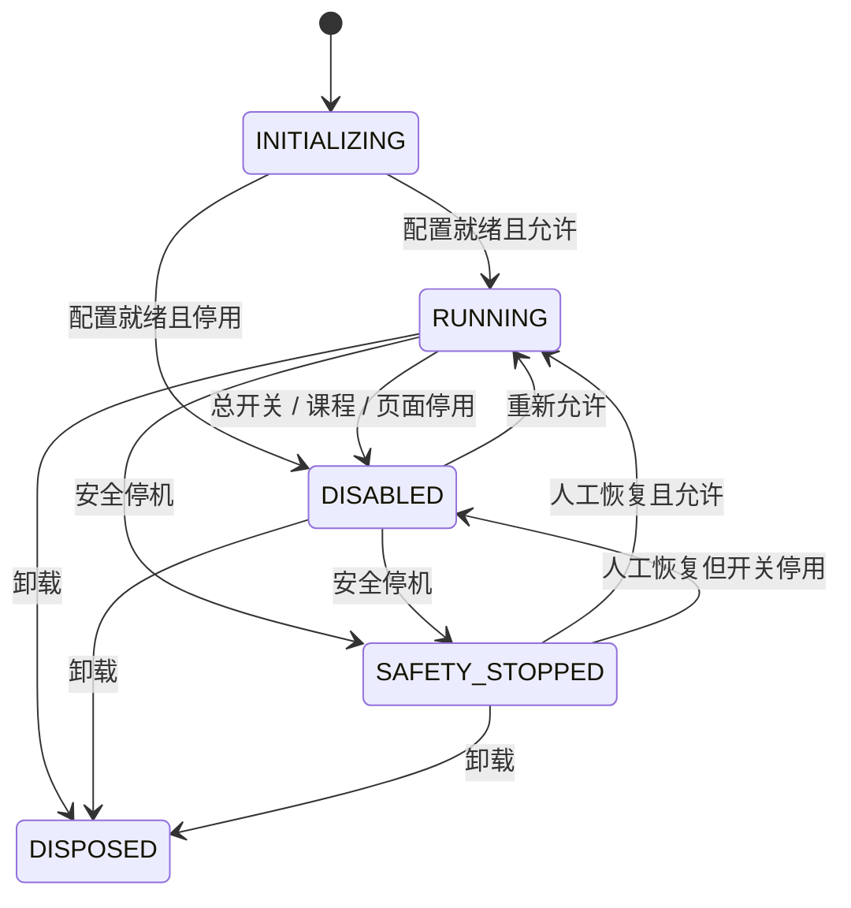

# 核心运行状态机

核对版本：4.20.3；日期：2026-10-14。实现入口为 [runtime.js](../apps/userscript/src/chaoxing-force-play/takeover/foundation/state/runtime.js)，公开入口为 `window.__CX_FORCE_PLAY.CoreState`。

## 状态与优先级

| 状态 | 条件 | 自动化许可 |
|---|---|---|
| `INITIALIZING` | 配置尚未就绪 | 拒绝 |
| `RUNNING` | 配置、课程、页面、父帧和安全条件全部允许 | 允许；仍需通过各子系统开关 |
| `DISABLED` | 总开关关闭、课程停用、页面 `cxforce=off` / `cx_force_off=1`，或同源父帧停用 | 拒绝 |
| `SAFETY_STOPPED` | 本帧或同源父帧已触发安全停机 | 拒绝 |
| `DISPOSED` | 已卸载 | 永久拒绝；重新注入创建新控制器 |

卸载是终态；安全停机优先于常规开关。同源子帧同时遵守自己的开关和父帧许可，不能通过开启子帧覆盖父帧停机。有效顶层的安全巡检覆盖同源子帧中的验证控件；跨域帧不能读取彼此控制器，由各自实例管理。

## 任务身份与取消

`canRun()` 同步复核输入；`state()` / `getSnapshot()` 返回当前状态，快照含状态、原因和递增 `epoch`。诊断报告显示这些字段；`EventBus.state.runtime` 是快照镜像，权威转换由 CoreState 管理。

异步任务在启动时调用 `capture(scope)`，执行后续动作前调用 `valid(token)`。令牌同时绑定本次注入、全局代次、子系统代次与同源祖先控制器代次；停止后恢复、重置后同题重发、父帧停止后恢复和卸载后重新注入均不能让旧令牌重新有效。

`invalidateScope(scope, reason)` 取消指定子系统。`onCancel(scope, fn)` 是持久订阅，返回幂等退订函数；全局状态变化取消全部作用域任务。`dispose()` 取消任务并清理订阅。`peekSnapshot()` 只供已经完成同步检查的内部祖先代次读取；许可判断使用 `canRun()` / `valid()`。

| 作用域 | 任务与资源 |
|---|---|
| `playback` | 同视频播放请求互斥，播放 Promise 的迟到拒绝不再触发静音重试；取消 playing 监听、超时及 MO 视频队列 |
| `quiz` | 单调会话代次、请求 ID 和独立超时；停止、重置、关闭答题后旧 AI / 视觉结果不能回填或提交 |
| `quiz-vision` | 直接视觉调用及 Reverse API `answer` 在入口捕获许可；等待截图、GM 凭据或流式响应后复核，取消时中止 endpoint 请求与 reader |
| `navigation` | `IDLE` / `NAVIGATING` / `LOCKED`，取消在途请求和导航定时器，副作用前再次检查开关 |
| `bridge` | 核心桥绑定本帧令牌和页面身份，同源请求共享；取消消费者，最后一个退出时中止网络请求，迟到 JSON 不再写入状态 |
| `main-loop` | 延迟扫描与站点调度必须持有有效令牌；停机/停用不重启循环 |
| `warmup` | 开源版 `armed` / `done` 在相同读写后端持久化；确认、停机、卸载取消延迟提示 |

每个视频的用户暂停、答题保持、结束锁和释放标记仍保留原有 `FLAGS` / WeakMap 协作接口。CoreState 管理全局运行许可和任务代次；它不替代题目表、视频状态或持久配置。

4.20.3 将题目请求的 `valid` 与 AbortSignal 从 `_quizVisionAnswer` 贯穿 `quizRecover`、`quizVisionAsk` 和端点请求；入口直接调用则创建自己的 `quiz-vision` 上下文。不得在 GM 读取结束后才捕获新令牌，否则旧任务可能借停止后的恢复重新获得许可。凭据就绪、发送前、响应处理和流式读取均按原任务身份复核；已经发出的请求被取消，不代表远端已经收到的数据可以撤回。

## 提交与导航边界

`quizStats.done` / `settled` 统计脚本已提交或识别结果页的题目；待确认、待复核和 AI 在途不计完成。`remaining` / `unsettled` 与这些等待字段共同约束 `doneAll` 和自动下一课。低置信文本与视觉答案均进入人工复核，保存草稿不计提交完成。

按钮被点击不代表平台服务端确认了成绩或任务进度。真实完成情况仍以平台页面与服务端状态为准。自动下一课默认关闭；桥只在插件和核心桥配置都允许时探测，兼容 `{chapters:[...]}` 与旧数组结构，导航失败允许重试，同一 video 元素换源后可处理新章节。

停止会释放视频续播、恢复暂停/速率原型、全局暂停包装和可恢复的 MediaSession 暂停入口；面板保留供人工操作。恢复需要当前条件重新允许，既有用户暂停和结束锁仍由其原接口管理。

## 验证与备份

新增回归为 `sim-core-state-transitions.js`、`sim-quiz-state-transitions.js`、`sim-auto-next-state-transitions.js` 和 `sim-warmup-state-transitions.js`；核心与预热测试直接加载 personal/open 两份完整产物。默认本地测试不包含 Playwright 浏览器场景。

4.20.2 的源码片段拆分保留本页状态与取消规则；完整语法等价和本次运行验证范围见 [拆分记录](../backups/refactor/2026-10-10/module-split/拆分说明.md)。

4.20.3 的私有凭据、延迟读取后的请求取消与当次回归范围见 [发布准备与验证记录](releases/4.20.3.md)。本页说明源码规则，测试是否通过按该记录的已填写结果判断，不从历史数字推断。

核心重写快照与原结果位于 [重写记录](../backups/refactor/2026-10-04/core-state/重写说明.md)。验证码检测、核心桥和逆向答案解析的后续修正见 [4.20.1 修正记录](../backups/fixes/2026-10-07/functions/修正说明.md)。构建与验证入口见 [贡献流程](../CONTRIBUTING.md)。
