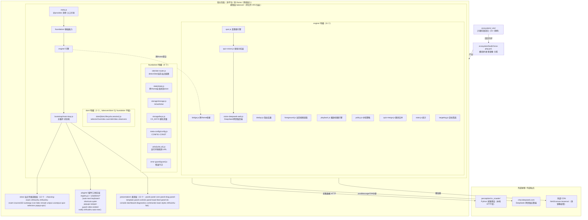
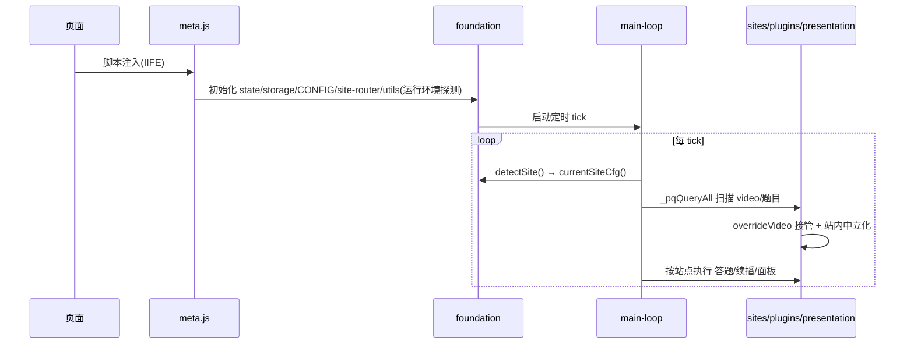
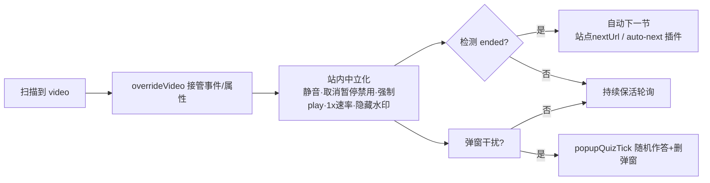
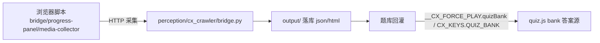
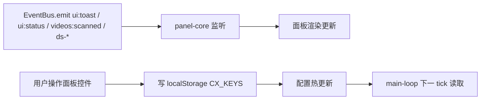
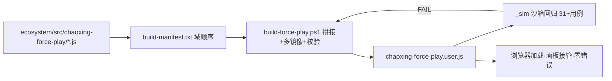
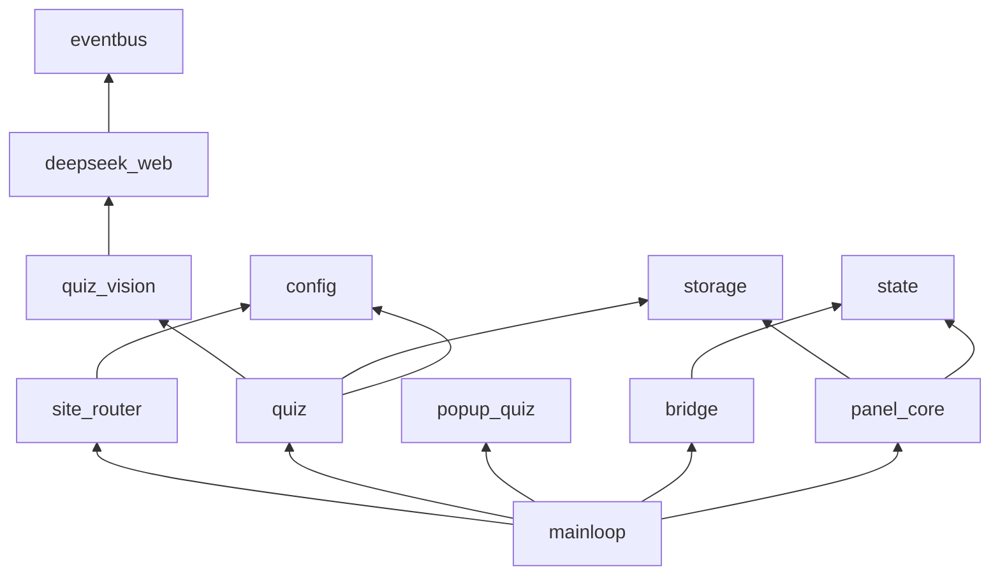

# 网课强制续播 · 系统架构图与设计文档

> 适用范围：`ecosystem/src/chaoxing-force-play/`（核心脚本）+ `perception/`（采集/爬虫平台）+ `ecosystem/build-force-play.ps1`（构建）+ `ecosystem/_sim/`（沙箱验证）。
> 本文档说明核心模块职责、分层边界与关键数据流。跨模块契约详见 `docs/CONTRACT.md` / `docs/CROSS_MODULE_CONTRACT.md`，治理红线见 `docs/ARCHITECTURE_GOVERNANCE.md`。

---

## 1. 系统总览

本系统是一个**注入到网课页面主世界的浏览器用户脚本（Tampermonkey/Violentmonkey）**，目标是在多平台（超星学习通、学银在线、智慧树/知到、中国大学 MOOC、icourse163、学堂在线、ICVE、人卫、Unipus、U 校园、实验空间等）上实现：

1. **强制续播**：接管视频播放、中和平台的反挂机检测（静音劫持、暂停按钮禁用、1x 速率限制、水印、弹窗干扰），并在播放结束后自动跳下一节。
2. **智能答题**：对作业/章节/考试题做"真答题"（抓题干+选项，经可插拔答案源求答案回填）；对上课弹窗做"随机作答+删弹窗"以消除干扰保续播。
3. **视觉对抗**：平台对题干做同形字/字体映射/Canvas 混淆时，把题目截图后由 OCR 或 AI 还原真实文本再作答。
4. **外部平台联动**：本地 Python 采集爬虫（`perception/cx_crawler/`）接收浏览器侧采集数据，并可将题库回灌给答题引擎。

脚本最终被 `build-force-play.ps1` 拼接为**单个 `chaoxing-force-play.user.js`**；运行期的全部逻辑位于一个 **IIFE 包装**内，模块间通过注释元标注（`@provides` / `@requires`）声明依赖，靠闭包共享全局名协作。

---

## 2. 分层架构图



---

## 3. 核心模块清单

### 3.1 接管层 `takeover/`

| 模块 | 职责 |
|------|------|
| `meta.js` | 运行时元信息（`__CX_FORCE_PLAY.REV` 等）+ `@provides` 清单 + 入口引导，构建一个 `window.__CX_FORCE_PLAY` 命名空间供跨 iframe 共享。 |
| `foundation/site/site-router.js` | `detectSite()` 按 host 识别站点；`SITES` 站点配置表；`currentSiteCfg()` 返回当前站点的能力集（接管策略、答题开关、隐私策略）。**站点隔离的唯一事实源**。 |
| `foundation/state/state.js` | 跨 iframe 全局状态 store（挂在 `window.__CX_FORCE_PLAY`）。多 iframe 下由顶层帧 owner 持有单一事实源，R5 机制防 owner 帧卸载后列表冻结。 |
| `foundation/state/metrics.js` | 运行指标（错误环形缓冲、计数等）。 |
| `foundation/storage/storage.js` | `lsGet/lsSet` + localStorage 读写封装。面板开关/配置均经此持久化。 |
| `foundation/storage/keys.js` | `CX_KEYS` 存储键名常量（题库/配置/开关）。 |
| `foundation/meta-config/config.js` | `CONFIG`（能力开关、隐私授权、视觉识别参数）、`CONST`（运行时常量/上限）。 |
| `foundation/utils/utils.js` | 运行环境探测（Tampermonkey/Violentmonkey、`@grant` 沙箱、iframe 嵌套 `isTopFrame`、跨域可达性）+ 通用工具。 |
| `foundation/utils/url.js` | URL 解析/匹配工具。 |
| `foundation/error-guard/guard.js` | 错误守卫（`safeGet`/`swallow` 等容错封装）。 |
| `dom/dom.js` | `selectorOverrides`（各站点选择器并集）、`_pqQueryAll`（best-effort 全量查询）、MutationObserver/网络监听封装。 |
| `dom/lifecycle.js` | 元素生命周期/挂载观测。 |
| `dom/session.js` | 会话/视频会话上下文。 |
| `engine/bridge.js` | 跨 iframe 桥接：postMessage 在同源 iframe 间同步视频列表/状态；跨域时回退各帧独立。 |
| `engine/dedup.js` | **指纹去重**：`_quizHandled` 等指纹的生成/查询/淘汰（站点无关去重，独立于 quiz.js）。 |
| `engine/foreground.js` | `currentVideo`/`foregroundVideo`：多视频页面中选取当前应接管的视频。 |
| `engine/playback.js` | **播放/续播引擎**：`overrideVideo`（事件+属性劫持）、自动播放、ended 检测与自动跳下一节。 |
| `engine/policy.js` | 中和策略：静音劫持还原、暂停禁用解除、速率限制绕过、水印隐藏等反挂机中和。 |
| `engine/targeting.js` | 视频/题目目标筛选（匹配接管/答题目标）。 |
| `engine/stats.js` | 运行统计（扫描/作答计数、错误累计）。 |
| `engine/quiz-merge.js` | 题块合并/归一（多来源题目结构对齐）。 |
| `engine/quiz.js` | **站点无关**真答题引擎：抓题干/选项 → 答案源（random/bank/ai/deepseek-web）→ 回填 → 二次确认提交。含严格 AI 模式与内存护栏。 |
| `engine/quiz-vision.js` | 视觉对抗层：html2canvas 多镜像截图 + tesseract OCR / endpoint 多模态识别，还原被混淆的题干文本。 |
| `engine/vision-deepseek-web.js` | DeepSeek 网页版视觉后端：登录态探测 + 跨页问答骨架（GM 存储中继跨源 / BroadcastChannel 同源）。 |
| `bootstrap/main-loop.js` | **主循环 / 状态机**：定时 tick，依站点配置执行【扫描→接管→中和→答题→续播→面板】。 |

### 3.2 站点专属适配层 `sites/`

按站点拆分，共 12 个文件：

- `chaoxing-exam.js`：超星学习通 / 学银在线（学银已并入此文件，非独立文件）。
- `zhihuishu.js`：智慧树 / 知到（含题目页场景自适应面板入口）。
- `zhihuishu-exam.js`：智慧树作业/考试专属面板与状态机（`__cxZhExamEnabled/Tick/AutoSubmitTick/SubmitNow/State`）。
- `icourse163.js`：中国大学 MOOC（爱课程）/ icourse163（**无 `mooc.js`**）。
- `xuetangx.js`：学堂在线。
- `icve.js`：ICVE（智慧职教）—— 与实验空间是**两个不同文件**。
- `ilabx.js`：实验空间（ilabx）。
- `renwei.js`：人卫。
- `unipus.js`：Unipus。
- `ucampus.js`：U 校园。
- `quiz-selectors.js`：各站点选择器并集（best-effort）。
- `popup-quiz.js`：上课弹窗"随机选→作答→删弹窗"骨架（站点无关，与 quiz 追求正确率不同）。

各自提供 `selectors` 同构映射 + 调用 `quizTick(sel)` / `popupQuizTick`，并暴露站点专属能力接口。

### 3.3 插件 / 工具库层 `plugins/` + `ui/addons/`

| 项 | 职责 |
|----|------|
| `registry.js` | 插件注册表，维护跨脚本契约全局 `__cxAddonQueue/__cxRegisterAddon/__cxRegisterCommand`。 |
| `ui/addons/auto-next.js` | 自动下一节。 |
| `ui/addons/keyboard-shortcuts.js` | 键盘快捷键（P 开关面板等）。 |
| `ui/addons/quiet-popups.js` | 静默弹窗（消干扰）。 |
| `ui/addons/tamper-guard.js` | 防篡改守卫。 |
| `ui/addons/video-ended-notify.js` | 视频结束通知。 |
| `ui/addons/zhihuishu-auto-next.js` | 智慧树自动下一节。 |

> 另有独立用户脚本：`perception/chaoxing-progress-panel.user.js`（进度面板）、`perception/chaoxing-media-collector.user.js`（媒体采集），与核心脚本并行分发。

### 3.4 表现层 `presentation/`（13 个）

| 模块 | 职责 |
|------|------|
| `panel.js` | 面板总装/编排，串联各子面板。 |
| `panel-core.js` | 面板装配 + 控制/命令事件绑定 + 主子页导航；跨帧 owner 抢占（R5/R11）。 |
| `panel-drag.js` | **Ninja FAB 拖拽**（含 lostpointercapture/blur 自愈），独立模块（非 panel-core）。 |
| `panel-template.js` | 面板 HTML 模板，**场景自适应**：视频页→「强制续播」面板；题目页→「作业/考试助手」面板；DeepSeek 页→「应答端控制台」。 |
| `panel-controls.js` | 面板控件绑定（开关/滑块持久化）。 |
| `panel-toast-feed.js` | 提示流（洞察页 toast 反馈子系统）。 |
| `panel-ds-console.js` | DeepSeek 应答端控制台绑定（`bindDSConsole`）。 |
| `dashboard.js` | 仪表盘（进度/状态聚合）。 |
| `diagnostics.js` | 诊断面板（错误/AI 作答段落）。 |
| `commands.js` | 命令注册与执行。 |
| `toast.js` | toast 子系统（与 panel-toast-feed 配合）。 |
| `styles.js` | 面板内联样式。 |
| `zhihuishu-fab.js` | 智慧树专属 FAB（独立于 panel-core）。 |

### 3.5 外部平台层 `perception/`（仓库根目录，与 `ecosystem/` 平级）

Python 采集爬虫 `cx_crawler/`：`bridge.py`（本地 HTTP 桥，接收浏览器采集）、`chapters.py` / `courses.py` / `quizzes.py` / `dump.py` / `render.py` / `session.py` / `api_client.py` / `heartbeat.py` / `config.py`。输出落 `output/`，可为答题引擎提供题库回灌。

### 3.6 构建与验证

- `build-force-play.ps1`：按 `build-manifest.txt` 的域顺序拼接（takeover 域内 `main-loop` 末位，整体末位为 IIFE 闭合 `})();`）+ 多镜像 CDN 注入 + 反向校验 + 卡控（`node --check`）。
- `ecosystem/_sim/`：jsdom 沙箱仿真回归（`sim-*.js`，构建后运行守护）。

---

## 4. 关键数据流

### 4.1 启动 / 接管流



### 4.2 续播防护流（超星/学银/MOOC 主场景）



### 4.3 真答题流（含视觉对抗）

```mermaid
flowchart TB
    Q[quizTick sel] --> G[抓题干/选项 selector并集]
    G --> FP[指纹去重 _quizHandled]
    FP --> VIS{题目文本被混淆?}
    VIS -->|是| HV[quiz-vision 截图<br/>html2canvas多镜像]
    HV --> OCR{视觉后端}
    OCR -->|tesseract| TR[本地OCR还原文本]
    OCR -->|endpoint| EP[多模态AI返回 text+answer]
    OCR -->|deepseek-web| DW[跨页问DeepSeek 截图+提示词]
    VIS -->|否| SRC[答案源: random/bank/ai<br/>(ai 源异步回填 quizBank→bank 命中)]
    TR --> SRC
    EP --> SRC
    DW --> SRC
    SRC --> BF[回填选项]
    BF --> STR{严格AI模式?}
    STR -->|失败| STOP[停下报错 _quizStrictFail<br/>不随机兜底·冷却重试]
    STR -->|成功/非严格| MK[标记handled→二次确认提交]
```

### 4.4 跨页 DeepSeek 应答流

```mermaid
flowchart LR
    subgraph COURSE["课程页(chaoxing/zhihuishu)"]
        C1[quiz-vision 截图] --> C2[_postChannel ds-ask<br/>img+stem+opts]
    end
    subgraph DS["DeepSeek 页(chat.deepseek.com)"]
        D1[responder 注入图片+提示词] --> D2[点发送 sendBtn]
        D2 --> D3[轮询回复完成 generatingSel]
        D3 --> D4[解析答案下标]
    end
    subgraph COURSE2["课程页"]
        C3[_postChannel ds-answer 回传] --> C4[回填选项]
    end
    C2 -->|GM存储中继(跨源)/BroadcastChannel(同源)| D1
    D4 -->|ds-answer| C3
```

### 4.5 跨进程桥接流（浏览器 → Python 爬虫）



### 4.6 面板 / UI 事件流



---

## 5. 跨模块契约（共享全局）

运行期闭包内共享的关键全局名（详见 `docs/CONTRACT.md`）：

| 类别 | 名称 |
|------|------|
| 状态命名空间 | `window.__CX_FORCE_PLAY`（state store / toolkit / quizBank / DS 状态） |
| 插件契约 | `__cxAddonQueue` / `__cxRegisterAddon` / `__cxRegisterCommand` |
| 配置/常量 | `CONFIG` / `CONST` / `CX_KEYS` |
| 事件总线 | `EventBus`（如 `ui:toast`、`ui:status`、`videos:scanned`、`targets:updated`、`zh-exam:state`、`ds-ask`、`ds-answer`、`ds-state`） |
| 工具函数 | `bestEffort` / `safeGet` / `swallow` / `lsGet` / `lsSet` |
| 站点 | `detectSite` / `currentVideo` / `allVideos` / `foregroundVideo` |
| 续播 | `applyUserRateAll` / `savePanelCfg` / `hidePanel` |
| 答题 | `quizTick` / `popupQuizTick` / `dsAvailable` |

`EventBus` 是 UI 与逻辑解耦的核心：`engine`/`bootstrap` 只发事件，`presentation` 只订阅渲染；用户操作写 localStorage，下一 tick 被主循环读取，形成"事件上行 + 存储下行"的单向数据流。

---

## 6. 关键设计模式与决策

1. **单文件 IIFE 包装 + 注释元标注**：58 个源文件在开发期分文件（`build-manifest.txt` 登记 56 个，外加 `meta.js` 与 `bootstrap/core.js` 由构建脚本作为 IIFE 入口前置注入，不计入 manifest），靠 `// @provides` / `// @requires` 声明依赖；构建时拼接为单个 `.user.js`（IIFE 由 `core.js` 的 `(function () {` 开启、末位 `})();` 闭合）。模块间用闭包共享全局名，避免真实 ESM 在用户脚本环境的兼容问题。
2. **站点隔离（detectSite）**：所有站点相关逻辑经 `currentSiteCfg()` 取能力集，禁止在核心逻辑里散落 `@match` host 判断。新增平台 = 新增 `sites/*.js` + 在 `SITES` 登记，不动核心引擎。
3. **答案源可插拔**：`quiz.js` 不凭空编造答案，答案来自 `random`（兜底）/ `bank`（本地题库）/ `ai`（自建端点）/ `deepseek-web`（跨页视觉）。严格 AI 模式下任何失败都"停下报错"而非随机兜底。
4. **视觉对抗（抗文本混淆）**：题干被同形字/字体映射/Canvas 混淆时，DOM textContent 不可信，一律以截图为准，经 OCR 或多模态 AI 还原。
5. **隐私优先**：外部 CDN 脚本（html2canvas/tesseract）须 `QUIZ_VISION_PRIVACY_OK` 显式授权才加载；未授权静默拦截并 toast 提示。
6. **多 iframe / 跨域鲁棒**：面板挂顶层帧（`window.top`）保证全站唯一；跨域不可达时 `safeGet` 回退本帧 document；owner 抢占（R5）+ 缓存节点脱连自愈（R11）防面板永久消失。
7. **内存护栏**：指纹/队列（_quizHandled、_quizAIFailed、_quizReviewItems、_quizPendingSubmit）带上限淘汰与 TTL，防超长会话无限增长。
8. **增量 diff 优化**：`_quizDirtyGen` 由 MutationObserver 递增，指纹跨 tick 缓存（`WeakMap`），稳态零重算 textContent。

---

## 7. 构建与验证



- **构建顺序**（单一事实源 = `build-manifest.txt`）：拼接为 `meta.js` + `core.js`(开 IIFE) + `takeover(foundation→engine→dom→bootstrap/main-loop)` → `sites` → `plugins(addons+registry)` → `presentation` + `})();`(闭 IIFE)。`main-loop.js` 在 manifest 第 24 行（sites 之前），是 takeover 域内的末位文件，**并非整体末位**（整体末位是 IIFE 闭合 `})();`）。
- **卡控**：`node --check` 语法校验 + `_sim` 回归（如 `sim-ninja.js` 面板点击自愈、`sim-quiz-vision.js` 视觉识别、`sim-zh-exam.js` 智慧树作业、`sim-popup-block.js` 弹窗彻底取消）。
- **构建命令**（本仓 Windows 环境）：用 `node_home` 的 node 跑 `powershell -ExecutionPolicy Bypass -File build-force-play.ps1`（避免 npm 被污染指向 .7z 路径）。

---

## 8. 模块依赖速查（精简）



---

> 维护提示：本文件为架构权威说明，若 `build-manifest.txt` 调整域顺序或新增 `sites/*.js` 模块，应同步更新第 3 节与第 7 节。
